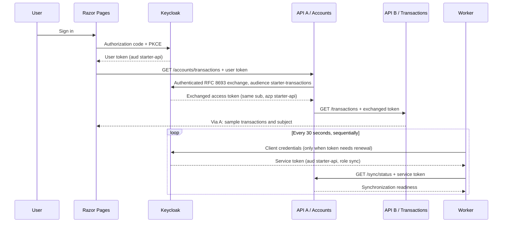

# User exchange and service authentication

The starter uses .NET 10, minimal APIs, and Keycloak **26.8.1**. The existing
`Keycloak.Starter.Api` remains API A (Accounts); its original endpoints and role
policies remain available. `Keycloak.Starter.Transactions` is API B.
`Keycloak.Starter.Worker` runs independently of browser sessions. There is no CLI
package in this implementation. The historical `starter-cli` realm client is
retained solely for compatibility with the original curl/smoke demonstrations;
it does not represent the new worker or a packaged CLI.



## Code organization

All entry points follow the existing Web composition pattern. `Program.cs`
registers options/services, builds the host, orders middleware and maps routes.
It contains no URL validation, role parsing, HTTP clients or endpoint handlers.

- `Configuration`: typed settings and `ValidateOnStart` option registration.
- `Security`: JWT configuration, validated role handling and authorization policies.
- `Endpoints`: route mapping and request handlers for each API.
- `Delegation`: API A's token exchange service and HTTP client registration.
- `OpenApi`: API A's development documentation configuration.
- Worker: separate options registration, token provider, bearer handler and job.

This is a small composition-based structure, consistent with the Web project.
There is no domain/database layer requiring a full Clean Architecture project
hierarchy or generic authentication framework. The small
`Keycloak.Starter.Authentication` project is reused by both APIs solely for
Keycloak resource-role normalization after JWT validation.

## Identity and trust boundaries

| Identity | Issued to / `azp` | Audience | Permission |
| --- | --- | --- | --- |
| Browser user | `starter-web` | `starter-api` | User's scoped API A reader/admin roles |
| User after exchange | `starter-api` | `starter-transactions` | User's `read-transactions` role |
| Service account | `starter-worker` | `starter-api` | `sync` only |

The browser holds a Secure, HttpOnly session cookie. The Web application stores
its tokens server-side, and uses the original user access token to call A. Only
`demo-reader` has both the reader role in A and read-transactions in B. The admin
role does not imply reader or transactions permissions.

A validates signature, issuer, audience and lifetime before looking at role
claims. `/accounts/transactions` additionally requires the reader role and
`azp=starter-web`. The realm disables service accounts and password grants for
that client, so this policy accepts its user sessions, not worker identities.
Adding a future interactive CLI requires an explicit approved client in this
policy and matching Keycloak configuration; a CLI is intentionally out of scope.

A authenticates itself at the discovered token endpoint using its confidential
client credentials (`client_secret_post`). Its client ID is also its resource
audience, as required for standard token exchange: the subject token must be
intended for the requester. The service uses FormUrlEncodedContent and these
parameters:

```text
grant_type=urn:ietf:params:oauth:grant-type:token-exchange
subject_token=<validated incoming access token>
subject_token_type=urn:ietf:params:oauth:token-type:access_token
requested_token_type=urn:ietf:params:oauth:token-type:access_token
audience=starter-transactions
client_id=starter-api
client_secret=<configured separately>
```

B independently validates JWTs with audience `starter-transactions`. It also
requires `azp=starter-api` and the validated
`resource_access.starter-transactions.roles` entry `read-transactions`.
The original Web token is rejected with 401 because it lacks B's audience. A
valid B token without its policy permission receives 403. A never forwards the
original token to B, returns tokens to callers, or caches exchanged user tokens.
The response includes `sub`, `authorizedParty`, a permitted operation and sample
data; it does not include the complete principal or raw claims. The data is a
fixed sample, not a real account database or an ownership authorization example.

The worker has no user context. Its own `sync` role and `azp=starter-worker` are
both required by `/sync/status`. It cannot call the user-delegated endpoint,
reader/admin endpoints, or B. `/me` remains the original generic authenticated
principal endpoint and accepts either identity type.

## Role normalization and Microsoft authentication patterns

Both APIs register `KeycloakJwtBearerEvents` with dependency injection and select
it through `JwtBearerOptions.EventsType`. Its `TokenValidated` override runs
after the bearer handler has validated the JWT. It deserializes the known
`resource_access` shape into a dictionary of typed client-role entries and maps
only the configured API audience's roles. API B now uses `RequireRole`, just
like API A, rather than parsing JSON inside an authorization assertion.

`TokenValidationParameters.RoleClaimType` points to the application-owned
`urn:keycloak-starter:api-role` claim. The handler rebuilds those claims from the
resource roles, ignoring any incoming claims with that name. Realm roles,
foreign-client roles and generic top-level role claims do not grant API
permissions. Missing or malformed role data grants no roles. Duplicate/blank
roles are ignored, and repeated mapping does not accumulate claims.

`IClaimsTransformation` is another supported extension point for enrichment
across authentication schemes. It may run on every `AuthenticateAsync` call,
so implementations must tolerate repeated calls. This starter uses the narrower
JWT validation event because this mapping is specific to a Keycloak bearer
scheme and its resource audience. Setting `RoleClaimType` alone cannot extract
roles from Keycloak's nested resource-access object.

References:
- [Microsoft: JWT OnTokenValidated](https://learn.microsoft.com/en-us/dotnet/api/microsoft.aspnetcore.authentication.jwtbearer.jwtbearerevents.ontokenvalidated?view=aspnetcore-10.0)
- [Microsoft: claims mapping and transformation](https://learn.microsoft.com/en-us/aspnet/core/security/authentication/claims?view=aspnetcore-10.0)

## Exact Keycloak 26.8.1 configuration

The source of truth is `keycloak/realm-export.json`; startup imports it only for
an absent realm. All checked-in secrets and passwords are **public local demo
values**, not deployment secrets.

| Client | Authentication / grants | Scope and exchange configuration |
| --- | --- | --- |
| `starter-web` | Confidential; authorization code + S256 PKCE; no implicit/password/service grants | Exact Web callback/logout URIs; API A roles and explicit A audience only |
| `starter-api` | Confidential; no browser/password/service grants | `bearerOnly=false`, `standard.token.exchange.enabled=true`, `fullScopeAllowed=false`, `basic`/`roles` scopes, B read role scope mapping |
| `starter-transactions` | Bearer-only resource | Own `read-transactions` role; no exchange requester capability |
| `starter-worker` | Confidential; service accounts only | `fullScopeAllowed=false`, A `sync` scope mapping, explicit A audience; exchange disabled |

Keycloak's standard **token-exchange-standard:v2** is enabled by default in
26.8.1. Only A has its client exchange switch enabled. The realm does not enable
legacy `token-exchange:v1`, preview features, or legacy fine-grained token
exchange permissions. Requester authentication, its presence in the original
audience, role scope mappings, and the user's assigned roles constrain exchange.
The audience parameter filters available audiences; it cannot invent an audience
outside the requester scope. B's audience is resolved from its role being in A's
scope and assigned to the user. Neither the Web nor worker client can request
that role directly, because it is outside their scope mappings.

This flow is commonly called user-delegated API access. In RFC 8693 terminology,
standard Keycloak V2 here has **impersonation semantics**, not an `act` actor
chain. The original user remains `sub`, and `azp` identifies A. Do not treat this
example as consent-based actor delegation, arbitrary impersonation, or a general
permission to exchange into any client.

Version-specific references:
- [Keycloak 26.8.1 token exchange guide](https://github.com/keycloak/keycloak/blob/26.8.1/docs/guides/securing-apps/token-exchange.adoc)
- [Keycloak 26.8.1 standard exchange provider](https://github.com/keycloak/keycloak/blob/26.8.1/services/src/main/java/org/keycloak/protocol/oidc/tokenexchange/StandardTokenExchangeProvider.java)
- [RFC 8693](https://www.rfc-editor.org/rfc/rfc8693.html)

## Token lifecycle and failure handling

Discovery and signature metadata are cached by the JWT bearer middleware. The
exchange client reuses that metadata rather than introducing a second discovery
cache. The worker discovers and retains its token endpoint once per process.
Both token clients verify the discovered issuer against the configured authority
and require HTTPS outside Development. Discovery configuration and the TLS
termination infrastructure are trusted administrative inputs. Do not point
metadata at a tenant-supplied URL. Backchannel HTTP redirects are disabled for
outbound token and API clients, preventing credential forwarding by redirects.

Every API A call obtains a new exchanged access token and uses it for that call
only. Exchange and downstream HTTP calls have 15-second client timeouts and
propagate request cancellation. OAuth rejection is not retried and returns a
safe 502; downstream rejection also returns 502; network failures return 503;
client timeouts return 504. These are dependency failures after A has already
authenticated/authorized the caller, so A does not turn B's 401 into a new user
login challenge. OAuth response bodies/descriptions and exceptions containing
provider content are never exposed.

The worker's singleton ServiceTokenProvider serializes acquisition using
SemaphoreSlim, including concurrent requests from different handler instances.
Tokens are reused until 30 seconds before expiry (10% early for tokens shorter
than five minutes). Renewal requests a new client-credentials token; there is no
refresh token. The expiration deadline starts before the HTTP request so network
latency does not extend token lifetime. Token responses must be Bearer with a
positive bounded lifetime. No token is persisted to disk.

A sequential PeriodicTimer loop prevents overlapping jobs. An idempotent
synchronization GET has at most three attempts, with 1s/2s delays, for network
failures, timeouts, 408, 429 or 5xx. OAuth error responses and API 401/403 are not
retried within a job; the next scheduled job can try again. Failed acquisitions
are not cached. Shutdown cancels timer waits, token acquisition, retry delays,
and API calls. Operational logs contain status/attempt information, never token
values, authorization headers, secrets or provider response bodies.

Already-issued JWTs remain valid until their expiry (subject to validation clock
skew). Revoking an original access token does not immediately revoke a derived
access token. Use short lifetimes and a different validation/revocation design
when immediate revocation is required. A keeps the existing bearer middleware
clock-skew behavior; B permits 30 seconds. Expiration tests set zero skew.

## Local deployment and production

Compose's canonical issuer is `http://localhost:<KEYCLOAK_PORT>/realms/starter`.
Browsers and host clients use that address. Containers retrieve metadata from
`http://keycloak:8080/realms/starter/.well-known/openid-configuration`; Keycloak's
`KC_HOSTNAME_BACKCHANNEL_DYNAMIC=true` advertises backchannel endpoints reachable
on the Compose network while retaining the canonical issuer. A calls B at
`http://transactions:8080`; the worker calls A at `http://api:8080`.
No custom hosts-file entries are required. Never replace container service names
with localhost or disable issuer checks to work around networking issues.

The complete default stack includes the existing HTTPS Web app. Run the
certificate preparation script before Compose (details in README and WEB.md).
Health checks cover Keycloak, PostgreSQL and both APIs; Web waits for both APIs.
The worker starts after A is healthy. It is a non-HTTP process with job-success
logs rather than a misleading TCP health check. Monitor job success/freshness in
a real deployment. API health endpoints report process liveness, not live
Keycloak connectivity. All application images run as .NET's non-root user.

Production requires a properly configured Keycloak server, HTTPS for authority,
metadata and API URLs, deployed certificates/TLS termination, rotated client
credentials supplied by a secret store, and exact callback URLs. Set
TokenExchange__Enabled=true and its settings explicitly; it is disabled by
default outside Development to preserve API-only deployments. Changing Compose
secret environment values alone does not rotate secrets in an imported realm:
change them in Keycloak too. Do not deploy the local start-dev realm as-is.


## Production reference

See [PRODUCTION.md](PRODUCTION.md) for the tested single-host proxy topology.
The shared authentication assembly also registers explicit trusted-proxy options
for Web and both APIs. This does not change JWT validation or role normalization.
The production issuer remains canonical HTTPS for both browsers and containers;
the development backchannel discovery configuration is unchanged.
