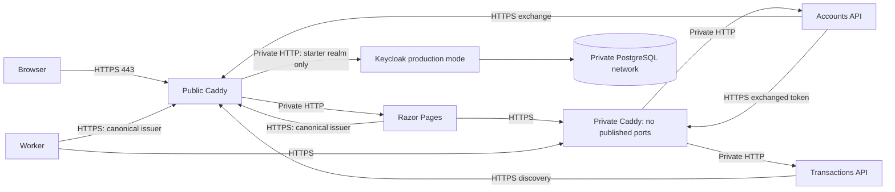

# Single-server HTTPS deployment reference

This example deploys the existing Web, Accounts API, Transactions API and worker
on **one trusted Linux Docker host**, using Caddy 2.11.7, Keycloak 26.8.1 and
PostgreSQL 17.11. It is a deployment reference, not a highly available platform
or a guarantee that an arbitrary environment is secure.

Use the standalone [production Compose file](../deploy/production/compose.yml).
Do **not** layer it over the development file: that would retain development
ports, credentials and environment settings.

## Topology and trust boundary



- Only the public proxy publishes host ports (80 and 443 by default).
- Public hostnames are `app.example.com` and `auth.example.com`.
- `accounts.example.com` and `transactions.example.com` are Docker DNS aliases
  for the private proxy. They need not have public DNS records.
- Keycloak has one fixed HTTPS issuer; browser and container discovery use the
  same canonical URL. There is no HTTP metadata exception or TLS-validation bypass.
- HTTPS terminates at the proxies. Their final HTTP hops are confined to the
  trusted host's Docker bridge. PostgreSQL is on a separate internal network.
  Host administrators and Docker administrators are inside this trust boundary.
- This is **edge TLS**, not end-to-end encryption of every container hop. For
  untrusted/multiple hosts or stricter isolation, use TLS to each backend and
  appropriate network policy; this example does not implement that topology.

Both APIs and Web process forwarded scheme/client IP only from their configured
proxy IP, with a one-hop limit and matching header counts. They do not process
`X-Forwarded-Host`; allowed hosts and the proxy's site routing constrain the host.
Caddy overwrites forwarded headers instead of accepting client-supplied values.
Keycloak also trusts only the public proxy IP. Middleware runs before HTTPS
redirection, authentication, and OIDC callback generation.

References: [ASP.NET Core proxy guidance](https://learn.microsoft.com/en-us/aspnet/core/host-and-deploy/proxy-load-balancer?view=aspnetcore-10.0),
[Keycloak proxy configuration](https://www.keycloak.org/server/reverseproxy),
[Caddy proxy behavior](https://caddyserver.com/docs/caddyfile/directives/reverse_proxy).

## Prerequisites

- Linux server with Docker Engine and Compose v2; sufficient memory for Keycloak,
  PostgreSQL, the applications and image builds. Test the capacity for your load.
- DNS records for the two public hostnames pointing to the server. Publish only
  80/443 through the firewall; restrict SSH separately. Docker port publication
  must be accounted for in the host firewall rules.
- A trusted TLS certificate and chain covering **all four** hostnames, plus its
  private key. A wildcard certificate obtained using DNS validation is one option.
  Certificate issuance/renewal is supplied by your infrastructure, not this repo.
- OpenSSL and jq for the one-time secret preparation script.
- A fresh deployment project/database. Existing realms require reviewed explicit
  Admin API/configuration-management changes; startup import skips them. This
  example does not add a migration engine or overwrite an existing realm.

## Prepare configuration, secrets and certificates

Run from the repository root:

```sh
cp deploy/production/.env.example deploy/production/.env
# Edit hostnames, canonical origins, administrator name, paths and network ranges.
export DEPLOYMENT_SECRETS_DIR=/srv/keycloak-starter/secrets
sh deploy/production/prepare-secrets.sh
```

Choose a writable absolute directory owned by the deployment operator. The
script refuses to overwrite any existing directory and creates unique random
credentials. If generation fails, the error explains that the directory may be
incomplete. Inspect it before proceeding; do not deploy partially generated
files. The script does not rotate credentials in an existing Keycloak or database.
The `.env` file contains configuration, not passwords. For standard port 443,
origins should be `https://app.example.com` and `https://auth.example.com`, without
an explicit `:443`; custom-port deployments must include the actual HTTPS port.

Supply these additional files in the generated directory:

```text
tls-chain.pem   # Leaf certificate followed by required intermediate certificates
tls-key.pem     # Unencrypted PEM private key for that certificate
ca-bundle.pem   # Trusted root CA bundle for .NET outbound HTTPS
```

For publicly trusted certificates, copy your Linux system root CA bundle to
`ca-bundle.pem`. For a private PKI, include its trusted root along with any
other roots the applications require. Do not put the leaf private key in the CA
bundle. No code disables certificate-chain or hostname validation.

Keep the host secrets directory at **0700**. The generated mounted files are
0444 so the different non-root container users can read their own secret mounts;
other host users cannot traverse the enclosing directory. Set the three supplied
files to 0444 too. Each service is given only its required secret files, mounted read-only by
Compose. The automated deployment tests verify the mount flags. Compose
file-backed secrets are protected files, **not an encrypted secret store**. Use
host disk protection, access controls and a managed secret system where required.
Never put this directory in Git, container image layers or build contexts.

The generated key-protection PFX is independent of the public TLS certificate.
It encrypts the Web Data Protection key ring, which protects server-side tickets.
Retain the original PFX (including its private key) and password with the
authentication volume across redeployments. Generating replacements prevents
reading keys protected by the original certificate. The preparation script removes
the intermediate unencrypted PEM private key after creating the PFX. Public TLS
renewal does not require rotating this key-protection certificate.

The static proxy IPs must be inside `APPLICATION_SUBNET` and outside
`APPLICATION_DYNAMIC_RANGE`. The default dynamic allocation range is the upper
half of the subnet, leaving the proxy IPs reserved. If the subnet overlaps your
host/VPN/Docker networks, change all related values together.

## Start and provision a user

Define a convenience function in your shell:

```sh
dc() {
  docker compose --env-file deploy/production/.env \
    -f deploy/production/compose.yml -p starter-prod "$@"
}
dc config --quiet
dc up -d --build --wait --wait-timeout 240
```

Compose starts the optimized Keycloak image with `start --optimized`, production
.NET environments, service-specific mounted JSON secrets, persistent PostgreSQL
and Web authentication volumes. The realm template imports only the application
clients, roles and worker service account. It has **no demo users, shared demo
passwords, historical curl clients, or public sample client secrets**.

The template uses Keycloak environment placeholders populated from the mounted
secret files. Runtime .NET settings read `/run/secrets/appsettings.json` after
the normal configuration providers; that file overrides the corresponding secret
values. Non-secret URLs and hostnames remain deployment environment settings.
Do not mount a JSON file that overrides unrelated deployment settings.

The public auth proxy allows `/realms/starter/*` and `/resources/*` only. It does
not expose the Admin Console, master realm login, metrics or management health.
An alternate admin hostname alone would not provide equivalent path isolation.
For initial provisioning, use Keycloak's bundled CLI inside its container:

```sh
dc exec keycloak /opt/keycloak/bin/kcadm.sh config credentials \
  --server http://localhost:8080 --realm master --user deployment-admin \
  --config /tmp/starter-admin.config
```

Use the administrator name you configured. The CLI prompts for the generated
bootstrap password; obtain it from your protected secret storage. This connection
is loopback within the Keycloak container. The CLI stores tokens in its private
configuration file, so do not export or retain that file unnecessarily.

Create a user and set an initial temporary password interactively:

```sh
dc exec keycloak /opt/keycloak/bin/kcadm.sh create users -r starter \
  -s username=alice -s enabled=true -s firstName=Alice -s lastName=Example \
  -s email=alice@example.com --config /tmp/starter-admin.config
dc exec keycloak /opt/keycloak/bin/kcadm.sh set-password -r starter \
  --username alice --temporary --config /tmp/starter-admin.config
dc exec keycloak /opt/keycloak/bin/kcadm.sh add-roles -r starter \
  --uusername alice --cclientid starter-api --rolename reader \
  --config /tmp/starter-admin.config
dc exec keycloak /opt/keycloak/bin/kcadm.sh add-roles -r starter \
  --uusername alice --cclientid starter-transactions --rolename read-transactions \
  --config /tmp/starter-admin.config
```

Do not supply passwords as command-line arguments or enable shell tracing.
The bundled 26.8.1 CLI prompts when `--new-password` is omitted. Do not leave
`KC_CLI_PASSWORD` set to the administrator password when setting a user's password.
Replace the temporary bootstrap administrator with your normal administrative
identity/process and remove it following your Keycloak operating procedure.
Keep deployment administrative credentials separate from all application clients.

Open the Web hostname, sign in, change the temporary password, and visit Reader
and Transactions. Transactions should show the same user subject and
`authorizedParty=starter-api`. Admin remains forbidden unless separately granted.
The worker should log `Synchronization status checked successfully (HTTP 200)`.

```sh
dc logs --tail=30 worker
```

## Operational configuration

| Setting | Meaning |
| --- | --- |
| `WEB_HOST`, `AUTH_HOST` | Public proxy hostnames |
| `WEB_ORIGIN`, `KEYCLOAK_ORIGIN` | Exact public HTTPS origins; issuer adds `/realms/starter` |
| `ACCOUNTS_HOST`, `TRANSACTIONS_HOST` | Private proxy hostnames, also covered by TLS certificate |
| `DEPLOYMENT_SECRETS_DIR` | Absolute protected host directory containing required secret files |
| `ReverseProxy__Enabled`, `ReverseProxy__KnownProxies__0` | .NET forwarding opt-in and exact trusted proxy IP |
| `Authentication__StoragePath` | Explicit persistent Web storage; required outside Development |
| `DataProtection__CertificatePath` | PFX with a readable private key; checked during startup |
| `SSL_CERT_FILE` | Mounted trusted root bundle for .NET HTTPS |

Application and Keycloak image versions follow the starter's pinned versions;
Caddy is pinned as well. Review release/security notices before deploying and
apply tested updates. Build/publish immutable application images in your registry
for a real release process; this reference uses Compose builds for reproducibility.

API Swagger/OpenAPI endpoints are absent in Production. Health checks verify
process/TCP readiness and Keycloak/database startup; they do not prove that all
OAuth operations are working. Monitor job success/freshness, dependency failures,
certificate expiry, disk usage and backup age externally. Access logging is not
enabled by these Caddyfiles; configure redaction before enabling request logging
so authorization headers, cookies and OIDC query parameters are not retained.

## Backup and restore drill

A recovery set consists of:

1. A consistent PostgreSQL backup (including the Keycloak database).
2. The Web authentication volume containing both tickets and its key ring.
3. The key-protection PFX/password and all relevant deployment secret files.
4. The deployment configuration, application image versions and realm template.

A realm export alone is not a complete Keycloak backup. Keep encrypted copies
off-host and test restoration regularly. Quiesce the applications and Keycloak
for this simple, coordinated backup procedure; PostgreSQL remains running:

```sh
umask 077
export STARTER_BACKUP_DIR=/srv/keycloak-starter/backups/release-001
mkdir -p "$STARTER_BACKUP_DIR"
dc stop gateway worker web internal-proxy api transactions keycloak
dc exec -T postgres pg_dump -U postgres -Fc keycloak > "$STARTER_BACKUP_DIR/keycloak.dump"
export STARTER_WEB_CONTAINER=$(dc ps -aq web)
docker run --rm --network none --volumes-from "$STARTER_WEB_CONTAINER":ro \
  --mount "type=bind,src=$STARTER_BACKUP_DIR,dst=/backup" \
  mcr.microsoft.com/dotnet/aspnet:10.0.13 \
  tar -C /app/authentication -czf /backup/web-auth.tar.gz .
# Copy the protected secrets/configuration into your encrypted backup system.
dc up -d --wait --wait-timeout 240
```

To restore, use a **new isolated Compose project and empty volumes**, the same
compatible Keycloak/application versions and the backed-up secrets. Restore into
that project before serving public traffic. Start only PostgreSQL first, then:

```sh
# dc must now target the recovery project's configuration and project name.
dc up -d --wait postgres
dc exec -T postgres pg_restore -U postgres --no-owner --role=keycloak \
  --clean --if-exists --exit-on-error -d keycloak < "$STARTER_BACKUP_DIR/keycloak.dump"
dc create web
export STARTER_WEB_CONTAINER=$(dc ps -aq web)
docker run --rm --network none --volumes-from "$STARTER_WEB_CONTAINER" \
  --mount "type=bind,src=$STARTER_BACKUP_DIR,dst=/backup,readonly" \
  mcr.microsoft.com/dotnet/aspnet:10.0.13 \
  tar -C /app/authentication -xzf /backup/web-auth.tar.gz
dc up -d --wait --wait-timeout 240
```

Validate login, logout, refresh, Transactions and worker access, then decide
whether to switch traffic. Test recovery away from the live system. Do not use
`down --volumes` on a deployment whose data you intend to keep. Restoring a
snapshot may also restore sessions/credentials that were later revoked; review
session invalidation during incident recovery. Application rollback does not
imply Keycloak database downgrade compatibility.

Client-secret rotation must update Keycloak and the matching mounted application
settings together, followed by recreating the affected application container.
Changing a secret file or realm template alone does not rotate Keycloak's stored
credential. Use your secret-management process and test the transition separately.

Public TLS certificate replacement requires recreating both Caddy containers so
file-backed secret mounts pick up replaced files. Check the replacement chain,
private key and SANs first, then use `dc up -d --force-recreate gateway internal-proxy`.
Do not regenerate application secrets or the key-protection PFX as part of TLS renewal.

## Automated validation and limitations

With Docker Desktop selected and Playwright Chromium installed, run `dotnet test`.
Run `sh tests/scripts/production-secrets.sh` with OpenSSL and jq to check the
setup script's successful output, permissions, refusal to overwrite, intermediate
key removal and injected OpenSSL failures. CI runs this check before the .NET suite.
The browser suite starts both development and Production-mode stacks with unique
projects, temporary secrets, a generated test CA and unused host ports. Production
.NET outbound HTTP uses real CA and hostname validation; only the disposable
Playwright browser context accepts the test CA without OS installation.

The Production fixture checks the shared login/PKCE, authorization, refresh,
logout, cookie replay, session-persistence, user token-exchange and worker journeys.
Additional tests exercise spoofed forwarded headers, HTTP-to-HTTPS redirects,
blocked admin/master/management paths, production API documentation restrictions,
worker authorization and PostgreSQL dump/restore into an isolated database. A
test-only override publishes the internal proxy on loopback for negative API tests;
the deployment Compose file does not publish it. Unit tests verify unknown proxy
headers are ignored and missing proxy trust configuration fails validation.

The automated fixture adds demo users only to its disposable realm copy. The
production realm template itself contains none. Real DNS, public CA issuance and
renewal, off-host backup encryption, host firewall configuration, monitoring,
external identity federation and disaster-recovery traffic switching remain
operator responsibilities. The example runs one Web instance and one Keycloak
instance: it does not provide multi-node storage, distributed refresh locks,
database HA, zero-downtime upgrades or an automatic realm migration system.
